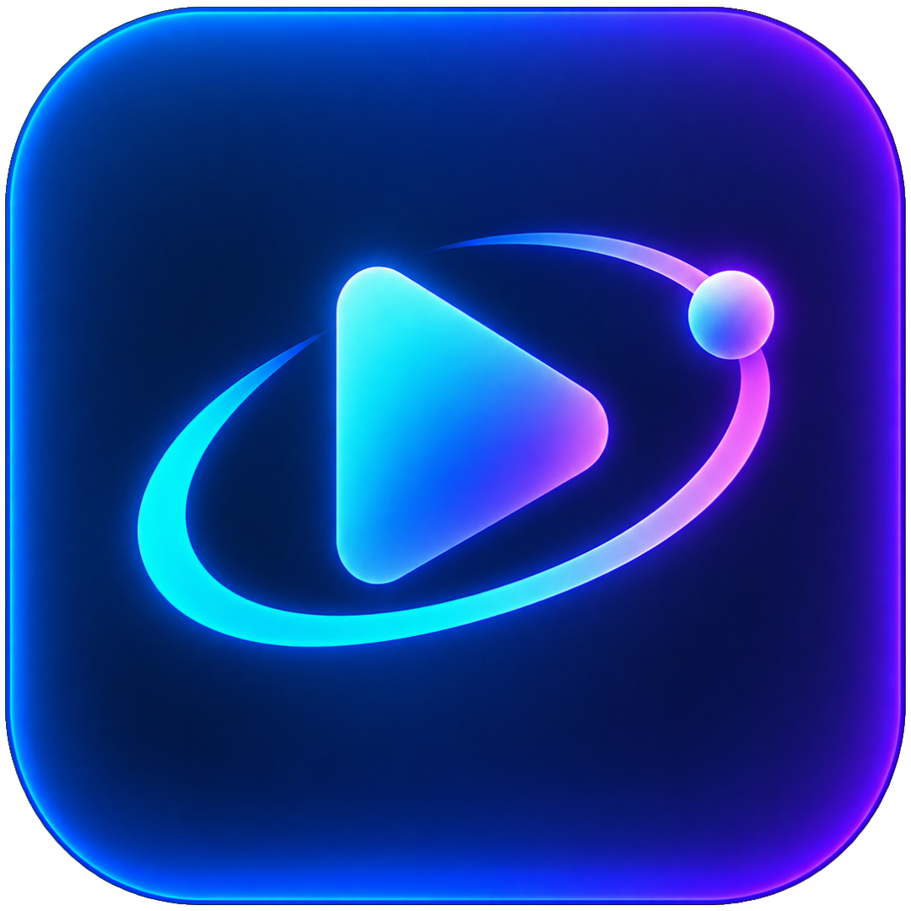

  

<h1 align="center">Usetopia</h1>

  A smooth, native video player for your own videos, media libraries and Usenet provider.

  <strong>Coming soon to the App Store, Google Play, the Microsoft Store and Flathub.</strong>

## About Usetopia

Usetopia plays your own local files, HTTP video links and media libraries in one player built for phones, desktops and TVs. A verified Usetopia account is required; your synced library and settings are end-to-end encrypted, so only your devices can read them.

Official add-ons from `get.usetopia.com` add title search, posters and ratings, catalogs, subtitles, Trakt and Simkl sync, AI suggestions and the on-device Usenet engine. Usetopia hosts and provides no videos.

## Where to get it

Usetopia is distributed only through:

- **App Store:** iPhone, iPad and Mac.
- **Google Play:** Android phones, tablets and Android TV.
- **Microsoft Store:** Windows 10 and 11.
- **Flathub:** Linux.

There are no direct downloads, and this repository publishes no installers.

## Free and Premium

- **Free:** Defaultarr search and title details, your own videos, the library and viewing progress, profiles and end-to-end encrypted sync.
- **Usetopia Premium:** every other add-on (Zanzibarr for Usenet, Metadatarr, Catalogarr, Libraryarr, Subtitlarr, Trackarr and Advisarr) on every device and profile of your account. Subscribe in the App Store or Google Play app, or through the web checkout on Windows, Linux and [account.usetopia.com](https://account.usetopia.com).

## Highlights

- Apps for iPhone, iPad, Mac, Android phones and TVs, Windows and Linux, with TV remote and keyboard control.
- One player for local files, HTTP links, media libraries (WebDAV, SFTP, FTP, SMB, NFS, Plex, Emby, Jellyfin) and Usenet.
- Continue Watching, history, favorites, watchlists and personal collections.
- TrueHD/Atmos, DTS-HD MA, AV1, HDR10 and Dolby Vision playback.
- Fourteen languages, including right-to-left layouts.

Provider credentials and API keys stay in the device's secure storage and are never bundled with Usetopia.

## Support and legal use

Use [GitHub Issues](https://github.com/MRKZYTSZ/Usetopia/issues) for public bug reports and feedback, or write to support@usetopia.com. Never include passwords, API keys, provider credentials or private media links in an issue.

Usetopia is a media player. Use it only for content you have the right to access. See the [Privacy Policy](https://usetopia.com/privacy/) and the [Terms of Use](https://usetopia.com/terms/).

## Repository notice

This public repository contains end-user information and branding assets only. Usetopia's source code is maintained privately and is not distributed from this repository.

Copyright © 2026 MRKZYTSZ. All rights reserved.
